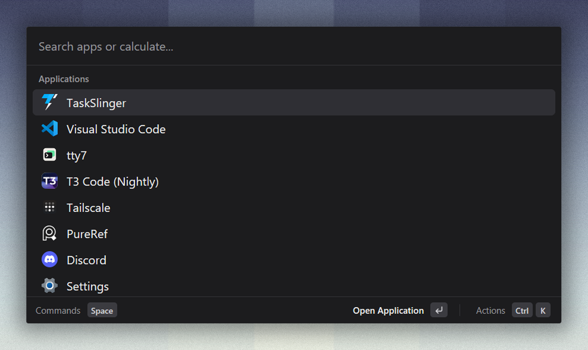

<div align="center">


<h1>Hayai</h1>

<p>A fast, low-memory Windows launcher to search apps, find files, and calculate from your keyboard.</p>

<p>
  <a href="https://github.com/Ariaryy/hayai/releases/latest"><strong>Download for Windows</strong></a> ·
  <a href="#install">Installation</a> ·
  <a href="docs/users/usage.md">User guide</a> ·
  <a href="#development">Development</a>
</p>

<p><sub>Native · Rust &amp; GPUI</sub></p>



</div>

Hayai brings app launching, indexed file search, and a calculator to a
lightweight native window. Press `Alt+Space` from anywhere to get started.

The name comes from 速い (*hayai*), Japanese for "fast."

## Features

| Feature | What you can do |
| --- | --- |
| App search | Find and launch desktop and Microsoft Store apps. |
| File search | Find files with the first-party [Scry Search](https://github.com/Ariaryy/scry-search) index. |
| Calculator | Do arithmetic, convert units and currencies, and work with timezones and dates. |
| Contextual actions | Reveal files in Explorer, copy paths, or launch apps as administrator. |
| Customization | Choose your themes, keyboard shortcuts, command aliases and launcher preferences. |

Hayai is built with Rust and GPUI, with no browser runtime. It stays in the
tray between searches, ready when you need it.

## Install

Download the latest installer or portable ZIP from
[GitHub Releases](https://github.com/Ariaryy/hayai/releases).

| Package | Setup |
| --- | --- |
| Installer | Install Hayai with the matching Scry Search package. |
| Portable ZIP | Extract the archive and run `hayai.exe`. |

App search and the calculator work immediately. File search uses Scry Search;
Hayai guides you through its setup, which requires Windows administrator approval.

Hayai is not code-signed yet, so Windows SmartScreen may warn about downloaded
builds. Use this repository's Releases page and verify downloads against the
included `SHA256SUMS.txt`.

See the [installation guide](docs/users/install.md) for setup, upgrades and removal.

## Try it

Press `Alt+Space`, then type an app name or a calculation:

```text
discord
15 km to miles
100 usd to inr
3pm est to ist
5 days from now
```

Press `Space`, then `f` to search files. Select a result with the arrow keys
and press `Enter`, or open its actions with `Ctrl+K`.

Read the [user guide](docs/users/usage.md),
[file-search guide](docs/users/file-search.md) and
[action reference](docs/users/actions.md) for more.

## Make it yours

Choose light and dark themes from Hayai, One Dark/One Light, Catppuccin,
Tokyo Night and Gruvbox. Set your own shortcuts and command aliases, and
choose how Hayai fits into your workflow.

Open Settings with `Ctrl+,` while Hayai is focused.

## Development

For source builds, see the [installation guide](docs/users/install.md).
The [architecture overview](docs/internal/architecture.md) explains the native
runtime, search providers and window lifecycle.

## Contributing

Issues and focused pull requests are welcome. Start with
[CONTRIBUTING.md](CONTRIBUTING.md) before submitting a change. Report security
issues as described in [SECURITY.md](SECURITY.md).

## License

Hayai is available under the [MIT License](LICENSE). Bundled artwork and theme
palettes retain their original licenses, listed in [third-party notices](THIRD_PARTY_NOTICES).
